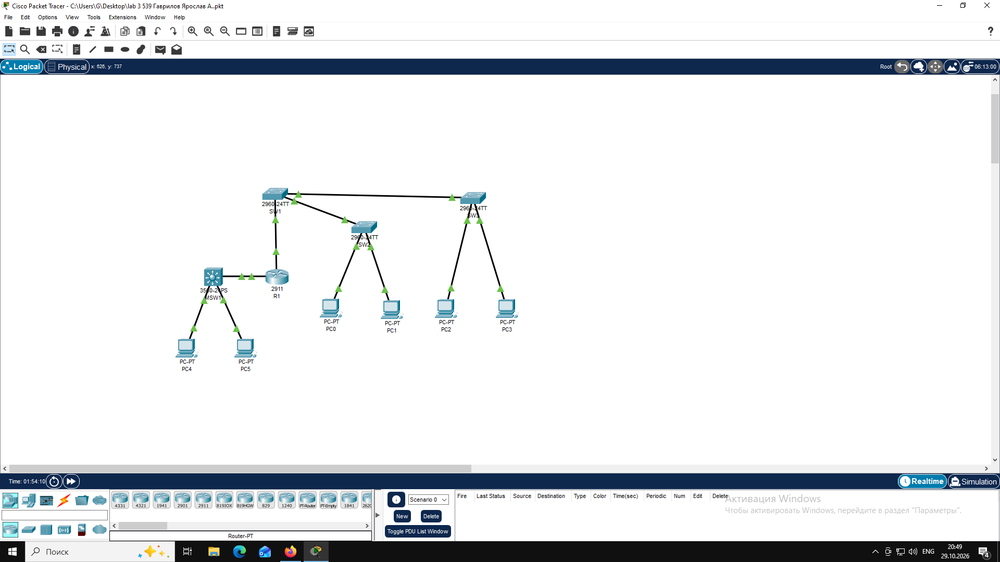
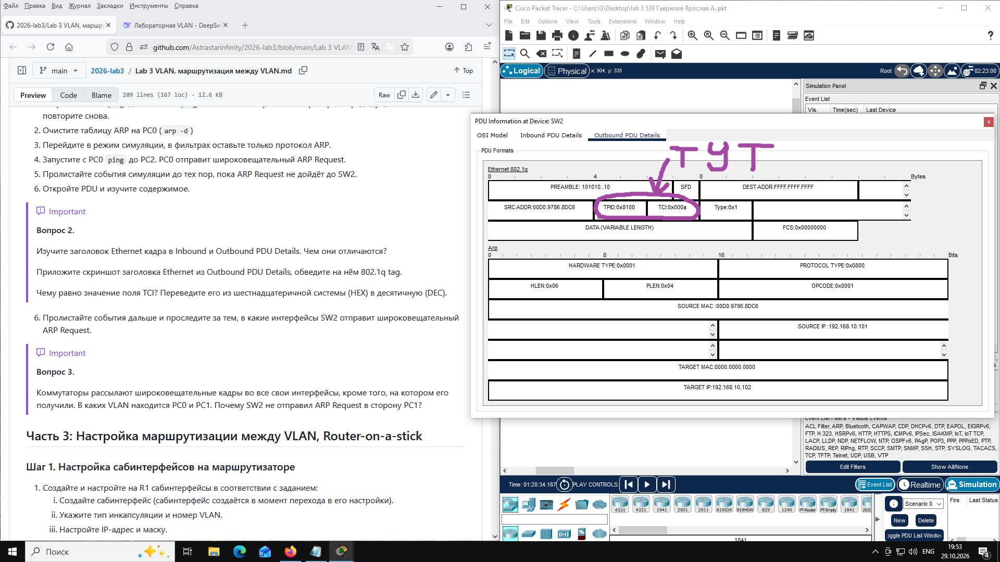

# Отчет по лабораторной работе №3
**Тема:** VLAN, маршрутизация между VLAN
**Выполнил:** Гаврилов Ярослав А., гр.539 ИВТ-21  

## Топология



## Ответы на вопросы

1. На коммутатотре есть VLAN 10студенты, 20 учителя, 99 натив, 1002 фдди, 1003 токен ринг,
1004 фддинет, 1005 трнет.
```text
SW2#show vlan brief

VLAN Name                             Status    Ports
---- -------------------------------- --------- -------------------------------
1    default                          active    Fa0/3, Fa0/4, Fa0/5, Fa0/6
                                                Fa0/7, Fa0/8, Fa0/9, Fa0/10
                                                Fa0/11, Fa0/12, Fa0/13, Fa0/14
                                                Fa0/15, Fa0/16, Fa0/17, Fa0/18
                                                Fa0/19, Fa0/20, Fa0/21, Fa0/22
                                                Fa0/23, Gig0/1, Gig0/2
10   STUDENTS                         active    Fa0/1
20   TEACHERS                         active    Fa0/2
99   NATIVE                           active    
1002 fddi-default                     active    
1003 token-ring-default               active    
1004 fddinet-default                  active    
1005 trnet-default                    active    
```
На VLAN 10 только Fa0/1.
```text
SW2#show vlan id 10

VLAN Name                             Status    Ports
---- -------------------------------- --------- -------------------------------
10   STUDENTS                         active    Fa0/1

VLAN Type  SAID       MTU   Parent RingNo BridgeNo Stp  BrdgMode Trans1 Trans2
---- ----- ---------- ----- ------ ------ -------- ---- -------- ------ ------
10   enet  100010     1500  -      -      -        -    -        0      0
```

```text
SW1#show interfaces trunk
Port        Mode         Encapsulation  Status        Native vlan
Fa0/23      on           802.1q         trunking      99
Fa0/24      on           802.1q         trunking      99
Gig0/1      on           802.1q         trunking      99

Port        Vlans allowed on trunk
Fa0/23      10,20,99
Fa0/24      10,20,99
Gig0/1      10,20,99

Port        Vlans allowed and active in management domain
Fa0/23      10,20,99
Fa0/24      10,20,99
Gig0/1      10,20,99

Port        Vlans in spanning tree forwarding state and not pruned
Fa0/23      10,20,99
Fa0/24      10,20,99
Gig0/1      10,20,99
```
2. Заголовок Ethernet кадра в Inbound (входящий на SW2 от PC0) не содержит тега 802.1q. Кадр передается
 в «чистом» виде, так как порт, на который он пришел, находится в режиме access (принадлежит одному VLAN).
Заголовок Ethernet кадра в Outbound (исходящий из SW2 в сторону SW1) содержит
 тег 802.1q (отображается как Ethernet 802.1q). Это происходит потому, что кадр отправляется
 в магистральный порт (Trunk), и коммутатор должен пометить его, чтобы соседний коммутатор знал, какому
 VLAN он принадлежит.



видно, что поле TCI равно 0x000a (в шестнадцатеричной системе).
Перевод в десятичную систему: 0x000A = 10 (DEC).
Это значение соответствует 10-му VLAN (VLAN 10 - STUDENTS).

3. SW2 не отправил ARP Request в сторону PC1, потому что PC1 находится в другом 
VLAN (другом широковещательном домене). Коммутатор рассылает широковещательные кадры только в 
пределах того VLAN, в котором они были созданы. Кадры из VLAN 10 изолированы от портов VLAN 20 на уровне L2. 
Для связи между ними нужна маршрутизация (Router-on-a-stick на R1)

PC0 находится в VLAN 10 (подключен к порту Fa0/1, который настроен как access VLAN 10).

PC1 находится в VLAN 20 (подключен к порту Fa0/2, который настроен как access VLAN 20).

4.
```text
C:\>ping 192.168.20.101

Pinging 192.168.20.101 with 32 bytes of data:

Request timed out.
Reply from 192.168.20.101: bytes=32 time<1ms TTL=127
Reply from 192.168.20.101: bytes=32 time<1ms TTL=127
Reply from 192.168.20.101: bytes=32 time<1ms TTL=127

Ping statistics for 192.168.20.101:
    Packets: Sent = 4, Received = 3, Lost = 1 (25% loss),
Approximate round trip times in milli-seconds:
    Minimum = 0ms, Maximum = 0ms, Average = 0ms
```

```text
R1#show ip interface brief
Interface              IP-Address      OK? Method Status                Protocol 
GigabitEthernet0/0     unassigned      YES unset  up                    up 
GigabitEthernet0/0.10  192.168.10.1    YES manual up                    up 
GigabitEthernet0/0.20  192.168.20.1    YES manual up                    up 
GigabitEthernet0/1     10.0.0.1        YES manual up                    up 
GigabitEthernet0/2     unassigned      YES unset  administratively down down 
Vlan1                  unassigned      YES unset  administratively down down
```

```text
SW1#show mac address-table
          Mac Address Table
-------------------------------------------

Vlan    Mac Address       Type        Ports
----    -----------       --------    -----

   1    0001.422a.8318    DYNAMIC     Fa0/23
   1    000c.8565.e318    DYNAMIC     Fa0/24
  10    0001.422a.8318    DYNAMIC     Fa0/23
  10    0030.a320.c301    DYNAMIC     Gig0/1
  10    00d0.9786.8dc6    DYNAMIC     Fa0/23
  20    0001.422a.8318    DYNAMIC     Fa0/23
  20    0030.a320.c301    DYNAMIC     Gig0/1
  20    00e0.b0eb.476e    DYNAMIC     Fa0/23
  99    0001.422a.8318    DYNAMIC     Fa0/23
```

MAC-адрес маршрутизатора R1 — 0030.a320.c301. В таблице коммутатора SW1 я вижу
 две записи с этим MAC-адресом:
```text
   10    0030.a320.c301    DYNAMIC     Gig0/1
   20    0030.a320.c301    DYNAMIC     Gig0/1
```
    Почему их две: Таблица MAC-адресов на современных коммутаторах Cisco ведется отдельно для
 каждого VLAN (per-VLAN MAC address table). Маршрутизатор R1 является шлюзом
 (Router-on-a-stick) для обоих VLAN — 10 и 20. Когда PC0 отправляет пакет PC1, R1 получает
 кадр из VLAN 10, маршрутизирует его и отправляет обратно в VLAN 20. Таким образом, MAC-адрес
 R1 фиксируется коммутатором в двух разных VLAN.

    Чем отличаются: Эти записи отличаются только номером VLAN (10 и 20), в котором был получен кадр.
 MAC-адрес, тип записи (DYNAMIC) и порт (Gig0/1) у них абсолютно одинаковые. Это не петля (loop) и не
 ошибка, а нормальное поведение сети при использовании одного физического интерфейса для нескольких VLAN.

5.
```text
MSW1#show ip interface brief
Interface              IP-Address      OK? Method Status                Protocol 
FastEthernet0/1        unassigned      YES unset  up                    up 
FastEthernet0/2        unassigned      YES unset  up                    up 
FastEthernet0/3        unassigned      YES unset  down                  down 
FastEthernet0/4        unassigned      YES unset  down                  down 
FastEthernet0/5        unassigned      YES unset  down                  down 
FastEthernet0/6        unassigned      YES unset  down                  down 
FastEthernet0/7        unassigned      YES unset  down                  down 
FastEthernet0/8        unassigned      YES unset  down                  down 
FastEthernet0/9        unassigned      YES unset  down                  down 
FastEthernet0/10       unassigned      YES unset  down                  down 
FastEthernet0/11       unassigned      YES unset  down                  down 
FastEthernet0/12       unassigned      YES unset  down                  down 
FastEthernet0/13       unassigned      YES unset  down                  down 
FastEthernet0/14       unassigned      YES unset  down                  down 
FastEthernet0/15       unassigned      YES unset  down                  down 
FastEthernet0/16       unassigned      YES unset  down                  down 
FastEthernet0/17       unassigned      YES unset  down                  down 
FastEthernet0/18       unassigned      YES unset  down                  down 
FastEthernet0/19       unassigned      YES unset  down                  down 
FastEthernet0/20       unassigned      YES unset  down                  down 
FastEthernet0/21       unassigned      YES unset  down                  down 
FastEthernet0/22       unassigned      YES unset  down                  down 
FastEthernet0/23       unassigned      YES unset  down                  down 
FastEthernet0/24       unassigned      YES unset  down                  down 
GigabitEthernet0/1     10.0.0.2        YES manual up                    up 
GigabitEthernet0/2     unassigned      YES unset  down                  down 
Vlan1                  unassigned      YES unset  administratively down down 
Vlan30                 192.168.30.1    YES manual up                    up 
Vlan40                 192.168.40.1    YES manual up                    up
```

```text
MSW1#show ip route
Codes: C - connected, S - static, I - IGRP, R - RIP, M - mobile, B - BGP
       D - EIGRP, EX - EIGRP external, O - OSPF, IA - OSPF inter area
       N1 - OSPF NSSA external type 1, N2 - OSPF NSSA external type 2
       E1 - OSPF external type 1, E2 - OSPF external type 2, E - EGP
       i - IS-IS, L1 - IS-IS level-1, L2 - IS-IS level-2, ia - IS-IS inter area
       * - candidate default, U - per-user static route, o - ODR
       P - periodic downloaded static route

Gateway of last resort is not set

     10.0.0.0/30 is subnetted, 1 subnets
C       10.0.0.0 is directly connected, GigabitEthernet0/1
S    192.168.10.0/24 [1/0] via 10.0.0.1
S    192.168.20.0/24 [1/0] via 10.0.0.1
C    192.168.30.0/24 is directly connected, Vlan30
C    192.168.40.0/24 is directly connected, Vlan40
```

```text
C:\>ping 192.168.40.101

Pinging 192.168.40.101 with 32 bytes of data:

Request timed out.
Reply from 192.168.40.101: bytes=32 time=4ms TTL=127
Reply from 192.168.40.101: bytes=32 time<1ms TTL=127
Reply from 192.168.40.101: bytes=32 time<1ms TTL=127

Ping statistics for 192.168.40.101:
    Packets: Sent = 4, Received = 3, Lost = 1 (25% loss),
Approximate round trip times in milli-seconds:
    Minimum = 0ms, Maximum = 4ms, Average = 1ms
```

```text
C:\>ping 192.168.10.101

Pinging 192.168.10.101 with 32 bytes of data:

Request timed out.
Request timed out.
Request timed out.
Request timed out.

Ping statistics for 192.168.10.101:
    Packets: Sent = 4, Received = 0, Lost = 4 (100% loss),
```